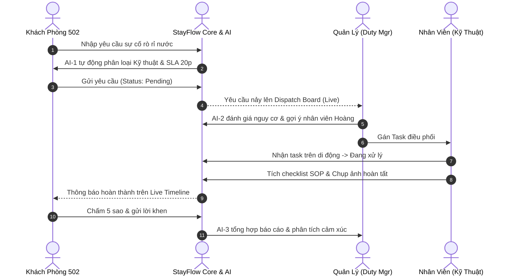

# LỘ TRÌNH & KỊCH BẢN TRÌNH CHIẾU KHÁCH HÀNG (STAYFLOW DEMO ROADMAP)

> **Dự án:** StayFlow – Nền Tảng Điều Phối Dịch Vụ Lưu Trú Khách Sạn (BTL-08)  
> **Mục tiêu:** Trình diễn một kịch bản khép kín, trực quan, chứng minh giá trị kinh doanh thực tế của hệ thống đối với Ban Giám đốc Khách sạn / Chủ đầu tư / Giảng viên chấm đề tài.

---

## 1. Bức Tranh Tổng Thể (The Pitch Narrative)

- **Vấn đề thực tế (The Pain Point):** Khách sạn 4-5 sao thường gặp tình trạng khách gọi lễ tân yêu cầu vặt (thêm nước, đổi khăn, sửa điều hòa) nhưng bị quên hoặc thất lạc phiếu ghi chép giấy; nhân viên buồng phòng không biết ưu tiên việc nào trước; khách sốt ruột không biết tiến độ; ban quản lý không có dữ liệu đánh giá chất lượng phục vụ thực tế.
- **Giải pháp StayFlow (The Value Proposition):** Số hóa 100% quy trình từ yêu cầu của khách -> điều phối thông minh có AI -> nhân viên nhận việc trên di động -> nghiệm thu thời gian thực -> tự động phân tích cảm xúc khách hàng.

---

## 2. Kịch Bản Trình Diễn Chi Tiết 6 Bước (Interactive Demo Script)

Người thuyết trình sử dụng **Thanh Demo Matrix (Demo Bar)** ghim ở đầu trang để chuyển đổi vai trò linh hoạt:

### Bước 1: Mở Cổng Hub & Giới Thiệu (Thời lượng: 1 phút)
- **Màn hình:** `index.html`
- **Thao tác:** 
  1. Trình chiếu banner tổng thể StayFlow.
  2. Bấm nút **"Reset Dữ Liệu Demo"** để khách hàng thấy toàn bộ hệ thống được đưa về trạng thái chuẩn bị ban đầu.
- **Lời thoại gợi ý:**  
  *"Kính thưa quý khách hàng, hôm nay chúng tôi xin giới thiệu giải pháp StayFlow – nền tảng điều phối dịch vụ lưu trú khách sạn theo thời gian thực. Để quý vị thấy rõ luồng vận hành thực tế, chúng ta sẽ bắt đầu bằng hành trình một ngày lưu trú của anh Nguyễn Văn An tại phòng Suite 502."*

---

### Bước 2: Khách Hàng Gửi Yêu Cầu & AI-1 Phân Loại (Thời lượng: 2 phút)
- **Màn hình:** `pages/guest/guest-service-request.html`
- **Thao tác:**
  1. Từ Demo Bar, bấm vào nút **[🛎️ Khách Phòng 502]**.
  2. Bấm vào gợi ý mẫu: *"Điều hòa phòng tôi bị kêu và chảy nước xuống thảm, cần kỹ thuật kiểm tra gấp!"*.
  3. Chỉ cho khách hàng thấy **AI-1 Request Classifier** ngay lập tức kích hoạt:
     - Nhận diện đúng bộ phận: **Kỹ thuật**.
     - Nhận diện mức SLA: **20 phút**.
     - Đưa ra giải thích thuyết phục: *"Phát hiện sự cố rò rỉ nước/điện có nguy cơ ảnh hưởng cơ sở vật chất. Tự động đề xuất chuyển bộ phận Kỹ thuật và nâng ưu tiên lên CAO."*
  4. Bấm **"Xác Nhận Gửi Yêu Cầu"**.
  5. Hệ thống chuyển sang `guest-my-requests.html`, hiển thị Live Timeline với trạng thái **"Đang chờ tiếp nhận"**.
- **Lời thoại gợi ý:**  
  *"Thay vì phải chờ máy lễ tân bận, khách hàng chỉ cần gõ ngôn ngữ tự nhiên. AI-1 tự động hiểu ngữ cảnh sự cố rò rỉ nước để phân loại sang bộ phận Kỹ thuật mà không bắt khách phải am hiểu cơ cấu phòng ban của khách sạn."*

---

### Bước 3: Quản Lý Khách Sạn Điều Phối Thông Minh (Thời lượng: 2 phút)
- **Màn hình:** `pages/manager/manager-dispatch-board.html`
- **Thao tác:**
  1. Bấm vào nút **[👔 Quản Lý Điều Phối]** trên Demo Bar.
  2. Khách hàng thấy ngay yêu cầu của phòng 502 vừa nảy lên đầu danh sách với biểu tượng **🔥 KHẨN CẤP**.
  3. Bấm vào yêu cầu phòng 502, bên phải kích hoạt **AI-2 Priority & Dispatch Assistant**:
     - Điểm rủi ro: **85/100**.
     - Gợi ý phân công cho: **Nguyễn Văn Hoàng** (Kỹ thuật viên đang có số task thấp nhất trong ca).
  4. Quản lý bấm nút: **"⚡ Xác Nhận Gán Task Cho Nhân Viên"**.
  5. Mở tab `manager-sla-monitor.html` để thấy đồng hồ SLA bắt đầu đếm ngược thời gian thực.
- **Lời thoại gợi ý:**  
  *"Ở góc độ nhà quản lý, sự cố rò rỉ nước tại phòng VIP không bị trôi đi. AI-2 đánh giá rủi ro hư hại nội thất và tự động tìm nhân viên kỹ thuật có tải công việc nhẹ nhất để đề xuất gán việc trong 1-chạm."*

---

### Bước 4: Nhân Viên Vận Hành Nhận Việc & Hoàn Tất (Thời lượng: 2 phút)
- **Màn hình:** `pages/staff/staff-task-board.html` & `pages/staff/staff-task-detail.html`
- **Thao tác:**
  1. Bấm vào nút **[🧹 Nhân Viên Vận Hành]** trên Demo Bar.
  2. Nhân viên thấy task phòng 502 nằm trong cột **"Chờ tiếp nhận"**.
  3. Bấm **"Nhận việc"** -> Thẻ nhảy sang cột **"Đang thực hiện"**.
  4. Bấm vào thẻ để mở `staff-task-detail.html`.
  5. Tích từng bước trong **Quy trình kiểm tra SOP**:
     - [x] Tiếp cận phòng và gõ cửa xưng danh theo quy chuẩn
     - [x] Kiểm tra hiện trạng thiết bị / cấp phát đầy đủ vật tư
     - [x] Làm sạch khu vực thao tác và xin xác nhận của khách
  6. Bấm vào khung **"Chụp/tải ảnh xác thực buồng phòng"** -> Giả lập đính kèm ảnh hoàn tất.
  7. Bấm **"Xác Nhận Hoàn Thành & Bàn Giao"**.
- **Lời thoại gợi ý:**  
  *"Giao diện của nhân viên được thiết kế chuẩn di động, giúp họ cập nhật trạng thái ngay tại cửa phòng mà không cần bộ đàm ồn ào. Ảnh minh chứng và checklist bảo đảm chuẩn mực dịch vụ 5 sao được thực hiện nghiêm túc."*

---

### Bước 5: Khách Hàng Nghiệm Thu & Đánh Giá 5 Sao (Thời lượng: 1.5 phút)
- **Màn hình:** `pages/guest/guest-my-requests.html` & `pages/guest/guest-feedback.html`
- **Thao tác:**
  1. Bấm lại nút **[🛎️ Khách Phòng 502]** trên Demo Bar.
  2. Màn hình `guest-my-requests.html` đã tự động cập nhật trạng thái: **"Đã hoàn thành"** với mốc thời gian cụ thể.
  3. Bấm nút **"⭐ Đánh Giá"** -> Mở `guest-feedback.html`.
  4. Chấm **5 sao**, chọn các tag: *"Tốc độ xử lý cực nhanh"*, *"Nhân viên lịch thiệp, chu đáo"*.
  5. Nhập nhận xét: *"Kỹ thuật viên Hoàng sửa điều hòa rất nhanh và dọn dẹp sạch sẽ sàn nhà. Rất hài lòng!"*.
  6. Bấm **"Gửi Đánh Giá"**.
- **Lời thoại gợi ý:**  
  *"Khách hàng hoàn toàn chủ động theo dõi được tiến trình phục vụ. Ngay khi nhân viên hoàn tất, khách có thể chấm điểm ngay trên điện thoại, tạo thành một vòng lặp khép kín của trải nghiệm lưu trú."*

---

### Bước 6: Báo Cáo Phân Tích Cảm Xúc & Cấu Hình Quản Trị (Thời lượng: 1.5 phút)
- **Màn hình:** `pages/manager/manager-service-report.html` & `pages/admin/admin-service-type-management.html`
- **Thao tác:**
  1. Mở `manager-service-report.html`.
  2. Chỉ cho khách hàng thấy **AI-3 Feedback Summarizer** đã tự động gom đánh giá của phòng 502 vào báo cáo tổng hợp:
     - Tỷ lệ hài lòng tăng lên.
     - Trích xuất điểm sáng: *"Tốc độ phục vụ nhanh và nhân viên chu đáo"*.
     - Cảnh báo điểm nghẽn: *"Bảo trì hệ thống nước nóng tầng trung"*.
  3. Mở `admin-service-type-management.html`: Trình diễn thao tác sửa nhanh thời gian SLA của một dịch vụ từ 30 phút thành 25 phút.
- **Lời thoại gợi ý:**  
  *"Toàn bộ dữ liệu phản hồi không nằm chết trong sổ lưu niệm mà được AI-3 phân tích sắc thái cảm xúc, giúp Ban Giám đốc nhìn thấy điểm sáng của đội ngũ cũng như những điểm nghẽn hạ tầng để cải tiến liên tục."*

---

## 3. Bảng Tóm Tắt Giá Trị Cho Khách Hàng (Business Impact Matrix)

| Tiêu chí | Trước khi dùng StayFlow | Sau khi ứng dụng StayFlow |
|---|---|---|
| **Thời gian phản hồi khách hàng** | 25 - 45 phút (Ghi sổ tay, gọi điện) | **10 - 15 phút** (Giảm hơn 50%) |
| **Tỷ lệ thất lạc yêu cầu** | 8 - 12% trong giờ cao điểm | **0%** (Số hóa và theo dõi SLA live) |
| **Minh chứng chất lượng dịch vụ** | Không có bằng chứng thực tế | Checklist SOP & Ảnh chụp xác thực |
| **Báo cáo điều hành** | Cuối tuần mới thống kê thủ công | **AI Insights cập nhật từng phút** |
