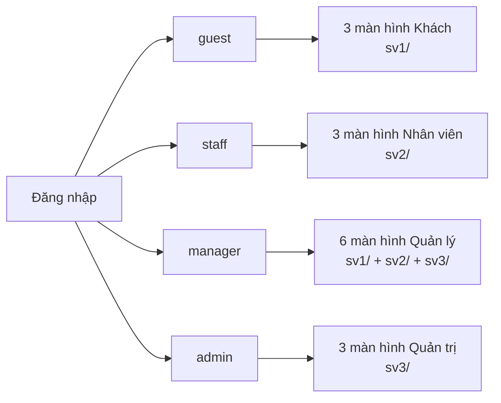

# StayFlow

## 1. Giới thiệu

Frontend prototype điều phối yêu cầu dịch vụ trong thời gian lưu trú của khách sạn, bài tập lớn **BTL-08 – CSE122**. Bản mã nguồn tích hợp phần việc SV1, SV2 và SV3; dữ liệu mặc định là dữ liệu giả trên trình duyệt, không có backend và không cần bước build.

Prototype gồm **4 vai trò** (Khách lưu trú, Nhân viên, Quản lý, Quản trị viên), **20 màn hình** (15 nghiệp vụ + 5 dùng chung) chia thành 3 gói `sv1/`, `sv2/`, `sv3/`, hỗ trợ tạo – điều phối – xử lý – theo dõi yêu cầu, SLA, ca làm việc, báo cáo ca và 3 tính năng AI mô phỏng.

## 2. Liên kết dự án

Tài liệu trong gói: [Kiểm kê màn hình](docs/screen-list.md) · [Vai trò, quyền hạn và tính năng](docs/roles-and-features.md).

| Hạng mục | Trạng thái |
|---|---|---|
| Repository GitHub | https://github.com/hinacchi-git/CSE122_67KTPM1_BTCK_Nhom4.git 
|Figma/canva | Folder .pdf đính kèm trên Repo
| Trello/Jira | https://trello.com/invite/b/6ade2994f84af2786fe33db6/ATTI29953d73941d80b12ac59874bb64e8a2CC9FE9F9/bảng-trello-của-toi | 
- **[Mở báo cáo lịch sử sử dụng AI — SV1, SV2, SV3](docs/ai-usage-report.md)** — prompt theo nhiệm vụ, phần AI hỗ trợ, lỗi/cách sửa và phần cần từng sinh viên xác nhận.

### Video OBS theo sinh viên

| Sinh viên | Họ tên | Playlist/video |
|---|---|---|
| SV1 | Lâm Hải Long | https://youtube.com/playlist?list=PLJ_SdHpeZlgM&si=sUvTYvnVB1aWRILC |
| SV2 | Nguyễn Tuyên Hoàng | https://www.youtube.com/playlist?list=PLG_VVWTVOGFg |
| SV3 | Phan Nhật Anh | https://www.youtube.com/playlist?list=PLWdPpuS8BLv8 |

## 3. Thành viên và phạm vi

| Sinh viên | Họ tên / GitHub | Phạm vi chính |
|---|---|---|
| SV1 - Lâm Hải Long| hinacchi-git | 7 màn hình: trang vào hệ thống, toàn bộ luồng Khách, quản lý loại dịch vụ |
| SV2 - Nguyễn Tuyên Hoàng| nghuang24 | 6 màn hình: trang lỗi, toàn bộ luồng Nhân viên, xếp ca và duyệt đổi ca |
| SV3 - Phan Nhật Anh| anh04570-sys | 7 màn hình: điều phối, SLA, báo cáo, quản lý nhân sự và toàn bộ khu Quản trị |
| Cả nhóm | — | `shared/`: schema dữ liệu, xác thực, UI, AI và review chéo |


## 4. Chức năng đã tích hợp

Khách lưu trú xem bảng tin, tạo yêu cầu dịch vụ và theo dõi/hủy yêu cầu. Nhân viên xem nhiệm vụ được điều phối, cập nhật trạng thái, ghi chú, xem ca, gửi báo cáo ca và đề xuất đổi ca. Quản lý điều phối yêu cầu, theo dõi SLA, xem báo cáo, cấu hình loại dịch vụ, quản lý nhân sự và duyệt đổi ca. Quản trị viên quản lý tài khoản, phân quyền, đăng bản tin và bật/tắt bảo trì; không truy cập dữ liệu vận hành.

| Vai trò | Chức năng chính | Số màn hình |
|---|---|---:|
| `guest` – Khách lưu trú | Bảng tin, tạo yêu cầu, theo dõi và hủy yêu cầu | 3 |
| `staff` – Nhân viên | Bảng nhiệm vụ, chi tiết nhiệm vụ, ca làm việc | 3 |
| `manager` – Quản lý | Điều phối, SLA, báo cáo, loại dịch vụ, nhân sự, xếp ca | 6 |
| `admin` – Quản trị viên | Bảng điều khiển, tài khoản, cập nhật hệ thống | 3 |



Sau đăng nhập, mỗi tài khoản được đưa về đúng khu vực theo role. Mở URL không đúng quyền sẽ bị chặn (thường chuyển tới `sv2/403.html`; trang Khách đưa tài khoản khác về khu vực của họ); chưa đăng nhập bị chuyển tới `sv1/login.html`.

Ba tính năng AI gồm: **AI-1** phân loại yêu cầu theo bộ phận, **AI-2** gợi ý mức ưu tiên khi điều phối và **AI-3** tóm tắt phản hồi của khách. Ngoài ra có trợ lý AI theo vai trò. Tất cả là mô phỏng bằng quy tắc, có trạng thái "chưa chắc chắn"/thất bại và cho phép người dùng chọn thủ công.

## 5. Công nghệ

HTML5, CSS3, JavaScript ES6 thuần và `localStorage`. Không dùng framework, không có backend, không có bước build. Gói hiện tại cũng không có `package.json`, Node.js server, Playwright hay bộ test tự động.

Giao diện chạy bằng một HTTP server tĩnh; đường dẫn nội bộ được xử lý bởi `APP_BASE` và `appUrl()` trong `shared/js/data.js`.

## 6. Cấu trúc hiện tại

```text
.
├── index.html                 # chuyển hướng về sv1/index.html
├── sv1/                       # 7 màn hình: vào hệ thống, Khách, loại dịch vụ
│   ├── *.html
│   ├── css/sv1.css
│   └── js/
├── sv2/                       # 6 màn hình: lỗi, Nhân viên, xếp ca
│   ├── *.html
│   ├── css/sv2.css
│   └── js/
├── sv3/                       # 7 màn hình: Quản lý, Quản trị
│   ├── *.html
│   ├── css/sv3.css
│   └── js/
├── shared/
│   ├── css/                   # base.css, responsive.css
│   └── js/                    # data.js, auth.js, ui.js, ai.js, manager-common.js
├── docs/
│   ├── roles-and-features.md
│   └── screen-list.md
└── _archive/                  # mã cũ, không dùng khi chạy
```


## 7. Chạy trên máy

Mở terminal tại thư mục gốc dự án và chạy một HTTP server tĩnh:

```sh
npx serve .
```

Hoặc nếu có Python:

```sh
python -m http.server 8080
```

Mở URL do server in ra; `index.html` ở gốc sẽ tự chuyển sang `sv1/index.html`. Có thể dùng VS Code Live Server từ thư mục gốc.

Luôn dùng HTTP, không mở trực tiếp HTML bằng `file://`, để đường dẫn tương đối và `localStorage` hoạt động ổn định.

## 8. Tài khoản thử nghiệm

Mật khẩu chung của cả 4 tài khoản demo là `123456`.

| Tên đăng nhập | Vai trò | Trang vào sau đăng nhập | Phạm vi |
|---|---|---|---|
| `khach` | `guest` – Khách lưu trú | `sv1/guest-dashboard.html` | 3 trang khu Khách |
| `nhanvien` | `staff` – Nhân viên Buồng phòng | `sv2/staff-task-board.html` | 3 trang khu Nhân viên |
| `quanly` | `manager` – Quản lý | `sv3/manager-dispatch-board.html` | 6 trang Quản lý trong `sv1/`, `sv2/`, `sv3/` |
| `admin` | `admin` – Quản trị viên | `sv3/admin-dashboard.html` | 3 trang khu Quản trị |

Đăng ký mới tạo tài khoản `guest`. Đây là session demo phía trình duyệt, không có bảo vệ hay phân quyền phía máy chủ; không nhập dữ liệu cá nhân hoặc thông tin thật.

## 9. Cấu hình API

Không có API và không có tệp cấu hình endpoint trong gói hiện tại. Mã nguồn không dùng `fetch`/XHR; toàn bộ dữ liệu đọc và ghi qua `localStorage`, còn AI là quy tắc tĩnh trong `shared/js/ai.js`.

Nếu bổ sung backend/API thật, cần một lớp proxy phù hợp và không đưa API key, token hay mật khẩu vào JavaScript/JSON frontend. Việc khai báo URL không tự tạo backend.

## 10. Dữ liệu và giới hạn

Dữ liệu dùng tiền tố `stayflow:`; phiên đăng nhập ở `stayflow:session`. `Store.get()` gieo dữ liệu mẫu ở lần đọc đầu tiên, `Store.set()` ghi lại sau mỗi thao tác và `Store.reset()` xóa dữ liệu seed cùng phiên.

| Nhóm dữ liệu | Seed | Ghi chú |
|---|---:|---|
| `users` | 4 | 4 vai trò demo |
| `serviceTypes` | 6 | SLA 15–120 phút |
| `stays` | 2 | Phòng 502 và 503 |
| `requests` | 10 | 5 trạng thái yêu cầu |
| `tasks` | 6 | Nhiệm vụ của nhân viên |
| `staff` | 5 | Hồ sơ dùng cho điều phối |
| `shifts` | 6 | Ca làm việc |
| `swapRequests` | 1 | Đề xuất đổi ca |
| `shiftReports` | 1 | Báo cáo ca |
| `feedback` | 5 | Phản hồi của khách |
| `systemLogs` | 5 | Nhật ký, bản tin |
| `flags` | 1 | Bảo trì và phiên bản |

Có thể đặt lại dữ liệu bằng nút **Đặt lại dữ liệu demo** trong trang Quản trị hoặc gọi `Store.reset()` trong console.

Dữ liệu chỉ liên thông trong cùng trình duyệt/origin, không đồng bộ giữa thiết bị. Seed dùng mốc thời gian tương đối; để lâu ngày có thể làm nhiều SLA đã trễ, nên đặt lại demo trước khi thuyết trình. AI hiện là mô phỏng, không phải mô hình ngôn ngữ hay tư vấn thật. Phân quyền chỉ kiểm tra phía client và Quản trị viên bị giới hạn không xem dữ liệu vận hành.

## 11. Kiểm thử

Chưa có test tự động, script kiểm thử hoặc biên bản kiểm thử trong gói. Không có `package.json`, `tests/` hay `tools/`, nên không thể chạy một lệnh integration test.

Checklist kiểm thử thủ công cần bổ sung:

- Mở đủ 20 màn hình và kiểm tra 4 luồng vai trò.
- Đăng nhập/đăng ký, sai mật khẩu, tài khoản bị vô hiệu hóa, chuyển hướng 403/404.
- CRUD yêu cầu, nhiệm vụ, ca, loại dịch vụ, tài khoản và bản tin.
- Tìm kiếm, lọc, kiểm tra hợp lệ biểu mẫu và các trạng thái rỗng/lỗi/thành công.
- AI-1, AI-2, AI-3 cùng trạng thái thất bại và phương án chọn thủ công.
- Đặt lại dữ liệu demo và kiểm tra lại sau khi tải lại trang.
- Responsive ở 375/768/1440 px và kiểm tra bàn phím.

## 12. Vấn đề còn biết

- Chưa có test tự động, biên bản kiểm thử, ảnh chụp màn hình hoặc bằng chứng responsive.
- `_archive/` chỉ là mã cũ, không thuộc luồng chạy hiện tại.
- Dữ liệu chỉ nằm trong một trình duyệt; seed dùng thời gian tương đối nên có thể bị trễ SLA.
- AI là mô phỏng quy tắc; phân quyền phía client không đủ an toàn cho sản phẩm thật.

## 13. Git và review

Quy trình cần bổ sung khi bàn giao: tạo repository, nhánh `main`/`dev`; mỗi task hoặc màn hình làm trên nhánh `feature/*`; commit theo Conventional Commits; mở PR vào `dev` và để thành viên khác review; bản ổn định đi qua PR `dev` → `main`. Giữ nguyên tác giả commit và không push trực tiếp vào `main`.

## 14. Deploy

Khi deploy, dùng static hosting trỏ vào thư mục gốc, bật HTTPS và kiểm tra: chuyển hướng từ `index.html`, toàn bộ 20 trang dưới đường dẫn repository/subpath, CSS/JS, đăng nhập, `localStorage`, 403/404, cửa sổ ẩn danh và thiết bị di động. Vì dự án dùng `APP_BASE` và đường dẫn tương đối, cần kiểm tra kỹ khi đặt dưới subpath.

## 15. Minh chứng và sử dụng AI

Xem [báo cáo AI theo nhiệm vụ SV1, SV2, SV3](docs/ai-usage-report.md): prompt có nguồn, phần AI hỗ trợ, lỗi/cách khắc phục và các trường xác nhận phần tự làm, tự kiểm chứng. Prompt phiên chung được phân loại theo nhiệm vụ, không mặc nhiên xác nhận ai nhập prompt. Từng sinh viên bổ sung thông tin cá nhân và video OBS thật. `docs/screen-inventory.md` và minh chứng thiết kế trước khi viết code chưa được xác minh trong bản này; bổ sung tài liệu hiện tại không chứng minh được thứ tự lịch sử. Không đánh dấu hoàn tất rubric khi chưa có bằng chứng.
